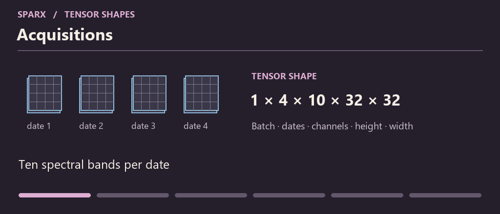

# SPARX

SPARX predicts a crop class for each pixel from a sequence of Sentinel-2 images. Two acquisitions can be adjacent in a sequence while lying weeks or months apart. SPARX gives each image an encoding of its acquisition date and uses the elapsed time between valid images to update a per-pixel state. A grouped temporal readout then builds the feature map that guides spatial segmentation.

## From an image sequence to a crop map



The animation follows a single 32 × 32 patch through the default 20-class model. All four date slots survive embedding and both TI-SSM layers. **The date dimension disappears at grouped temporal selection.** At each pixel and date, a learned linear projection maps all 160 features to eight scores. Each group applies a softmax across valid dates and sums its 20-channel date features using those weights. In the illustrated group, days 10, 40 and 130 receive weights of 0.10, 0.20 and 0.70. Day 60 is masked. Their pooled features form a 160-channel map. The U-Net uses this map for spatial prediction, and the refinement head reuses it to estimate boundaries and affinities between neighboring pixels.

## How TI-SSM advances between observations


Follow one state channel at one pixel. Day 10 supplies the first input. Day 40 advances the state by 30 days. The masked observation on day 60 leaves the state, stored input and last valid date unchanged. When day 130 arrives, TI-SSM therefore advances by **90 days**.

The slate-blue vector shows the previous state. As the copper segment grows, the history decays and rotates according to the effective interval. The orchid segment adds the contribution of the previous and current valid inputs. Its endpoint is the new state. The animation uses illustrative inputs, a decay rate of 2.5 per year, one rotation per year and a unit content adjustment. In the model, decay and rotation rates are learned per channel, and the current feature can rescale the elapsed interval. Each layer projects the real part of its 64-channel state back into the 160-channel observation feature.

## Semantic segmentation results

| Benchmark | Evaluation | mIoU (%) | Boundary F1 (%) |
| --- | --- | ---: | ---: |
| PASTIS-S2 | Five folds, mean ± standard deviation | 69.78 ± 1.21 | 83.93 ± 0.27 |
| MTLCC | Fixed test split | 90.95 | — |

On PASTIS-S2, keeping the frame encoder, grouped readout and spatial decoder while removing cross-date interaction gives 68.43% mIoU. Adding TI-SSM brings the score to 69.78% (+1.35 percentage points). The first result shows what date-specific features and temporal pooling can recover on their own. The difference measures the additional gain from interval-aware interaction in this architecture.

## Run a forward pass

Use Python 3.10 or 3.11 with a PyTorch build compatible with your environment. From the repository root, run:

```bash
python -m pip install -e .
```

The Python model is exported as `SPARXO`. This example uses the same four acquisition dates as the TI-SSM animation. Dates are elapsed days since 2018-01-01. Each sample must have at least one valid observation.

```python
import torch
from sparxo import SPARXO

model = SPARXO(num_classes=20).eval()
images = torch.randn(1, 4, 10, 32, 32)
dates = torch.tensor([[10., 40., 60., 130.]])
valid = torch.tensor([[True, True, False, True]])

with torch.inference_mode():
    output = model(images, dates, valid, return_aux=True)
    crop_map = output["logits"].argmax(dim=1)

print(output["temporal_feature"].shape)  # [1, 160, 32, 32]
print(output["logits"].shape)            # [1, 20, 32, 32]
print(crop_map.shape)                    # [1, 32, 32]
```

## Train and evaluate

For PASTIS-S2, point `data.root` in `configs/pastis.yaml` to the extracted PASTIS-R dataset. The default configuration trains on data folds 1–3, validates on fold 4 and tests on fold 5. This is the first of the five runs reported above. For MTLCC, set the data paths in `configs/mtlcc_scratch.yaml` for the 2016 split. [PASTIS-R data](https://zenodo.org/records/5735646) · [MTLCC data](https://zenodo.org/records/5712933)

```bash
# Train on the selected dataset
bash scripts/train.sh configs/pastis.yaml
bash scripts/train.sh configs/mtlcc_scratch.yaml

# Evaluate the validation-selected PASTIS checkpoint
python -m sparxo.runtime.train --config configs/pastis.yaml \
  --evaluate outputs/sparxo_v2_u4_pastis_fold5_seed42/checkpoints/best_val.pt \
  --evaluate-test
```
