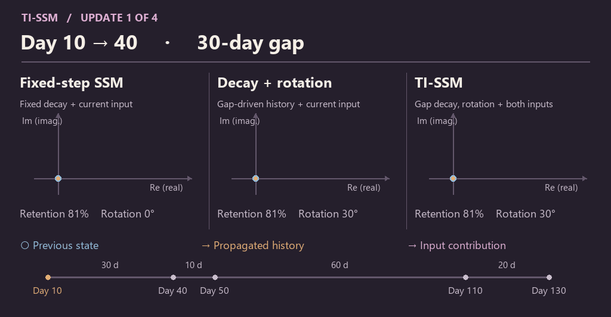

# SPARX

SPARX predicts a crop class for each pixel from a sequence of Sentinel-2 images. Two acquisitions can be adjacent in a sequence while lying weeks or months apart. SPARX gives each image an encoding of its acquisition date and uses the elapsed time between valid images to update a per-pixel state. A grouped temporal readout then builds the feature map that guides spatial segmentation.

## 🛰️ From an image sequence to a crop map


The animation follows a single 32 × 32 patch through the default 20-class model. All four date slots survive embedding and both TI-SSM layers. **The date dimension disappears at grouped temporal selection.** At each pixel and date, a learned linear projection maps all 160 features to eight scores. Each group applies a softmax across valid dates and sums its 20-channel date features using those weights. In the illustrated group, days 10, 40 and 130 receive weights of 0.10, 0.20 and 0.70. Day 60 is masked. In the animation, dates run across columns and groups run down rows. Each row pools across valid dates. The eight resulting 20-channel blocks move from their rows into a single horizontal strip, in group order, to show the 160-channel feature at one pixel. The U-Net uses this map for spatial prediction, and the refinement head reuses it to estimate boundaries and affinities between neighboring pixels.

## ⏱️ How TI-SSM advances between observations



All three examples start with a stored state of magnitude 0.22 on day 0. Updates occur on days 15, 35, 45 and 90, after gaps of 15, 20, 10 and 45 days. The upper row follows one channel in the complex plane; the lower row plots its magnitude against acquisition day. Copper traces history propagation and pink shows the contribution added at an observation.

- **SSM(ZOH).** This example uses a fixed unit model step and holds the input constant within that step. The history coefficient is exactly 1. Magnitude stays flat throughout every gap and changes only when an input arrives.
- **Propagation alone.** The stored state decays and rotates without receiving new input. Its magnitude traces one continuous exponential decay across all four intervals.
- **TI-SSM.** Each interval starts at the preceding updated state. Its magnitude decays until the next observation; the interval-weighted endpoint inputs then update the state at that date. Rotation is visible in the upper row.

## 📊 Semantic segmentation results

| Benchmark | Evaluation | mIoU (%) | Boundary F1 (%) |
| --- | --- | ---: | ---: |
| PASTIS-S2 | Five folds, mean ± standard deviation | 69.78 ± 1.21 | 83.93 ± 0.27 |
| MTLCC | Fixed test split | 90.95 | — |

On PASTIS-S2, keeping the frame encoder, grouped readout and spatial decoder while removing cross-date interaction gives 68.43% mIoU. Adding TI-SSM brings the score to 69.78% (+1.35 percentage points). The first result shows what date-specific features and temporal pooling can recover on their own. The difference measures the additional gain from interval-aware interaction in this architecture.

## ▶️ Run a forward pass

Use Python 3.10 or 3.11 with a PyTorch build compatible with your environment. From the repository root, run:

```bash
python -m pip install -e .
```

The Python model is exported as `SPARXO`. This example includes a masked acquisition on day 60. Dates are elapsed days since 2018-01-01. Each sample must have at least one valid observation.

```python
import torch
from sparxo import SPARXO

model = SPARXO(num_classes=20).eval()
images = torch.randn(1, 4, 10, 32, 32)
dates = torch.tensor([[10., 40., 60., 130.]])
valid = torch.tensor([[True, True, False, True]])

with torch.inference_mode():
    output = model(images, dates, valid, return_aux=True)
    crop_map = output["logits"].argmax(dim=1)

print(output["temporal_feature"].shape)  # [1, 160, 32, 32]
print(output["logits"].shape)            # [1, 20, 32, 32]
print(crop_map.shape)                    # [1, 32, 32]
```

## ⚙️ Train and evaluate

For PASTIS-S2, point `data.root` in `configs/pastis.yaml` to the extracted PASTIS-R dataset. The default configuration trains on data folds 1–3, validates on fold 4 and tests on fold 5. This is the first of the five runs reported above. For MTLCC, set the data paths in `configs/mtlcc_scratch.yaml` for the 2016 split. [PASTIS-R data](https://zenodo.org/records/5735646) · [MTLCC data](https://zenodo.org/records/5712933)

```bash
# Train on the selected dataset
bash scripts/train.sh configs/pastis.yaml
bash scripts/train.sh configs/mtlcc_scratch.yaml

# Evaluate the validation-selected PASTIS checkpoint
python -m sparxo.runtime.train --config configs/pastis.yaml \
  --evaluate outputs/sparxo_v2_u4_pastis_fold5_seed42/checkpoints/best_val.pt \
  --evaluate-test
```
